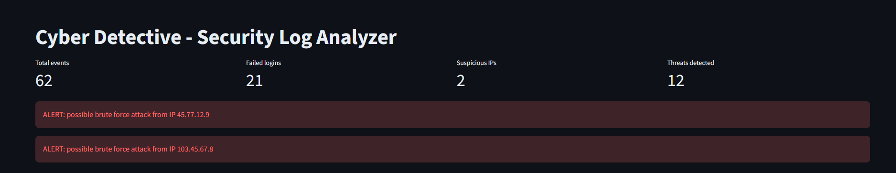
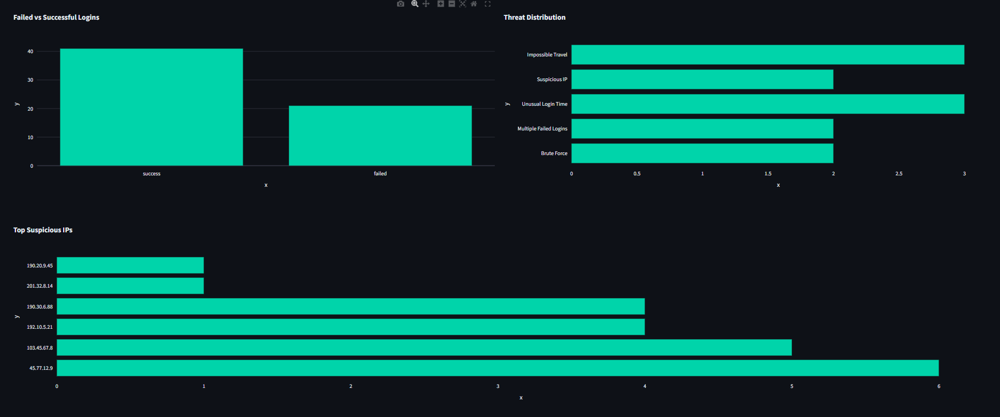
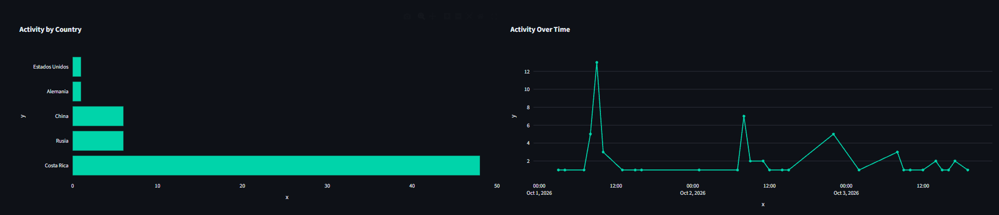
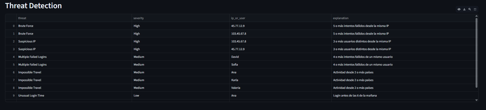
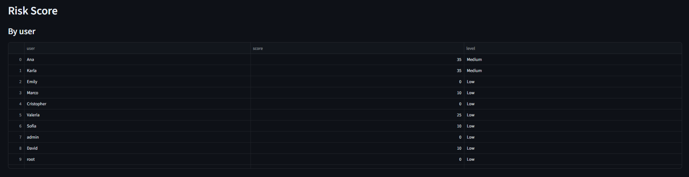

# Cyber Detective — Security Log Analyzer

A web application built with Python that analyzes security logs, detects suspicious behavior with simple rules, and shows the results in an interactive dashboard.

## Project Overview

Cyber Detective loads a CSV file with login activity, applies five detection rules, calculates a risk score for each user and each IP address, and shows everything in a dark, SOC-style dashboard built with Streamlit and Plotly.

This is an educational project. It uses **fictional data** and simple rules to practice data analysis and cybersecurity fundamentals.

## Problem

Security teams receive thousands of log lines every day. Reading them one by one is not possible, so analysts need a quick way to see which activity looks suspicious and which IPs or users need attention first.

## Objectives

- Load and clean a security log dataset with Pandas.
- Detect common suspicious behaviors with clear, explainable rules.
- Calculate a simple risk score to prioritize alerts.
- Show the results in an interactive dashboard.

## Features

- Metric cards: total events, failed logins, suspicious IPs, threats detected.
- Red alerts for possible brute force attacks.
- Interactive charts: failed vs successful logins, threat distribution, top suspicious IPs, activity by country, activity over time.
- Event log table with a status filter.
- Threat detection table with severity and a short explanation.
- Risk score tables by user and by IP.
- Dark interface inspired by a Security Operations Center (SOC).

## Technologies

- Python
- Pandas (data loading, cleaning, and analysis)
- Plotly (interactive charts)
- Streamlit (web dashboard)

## Dataset

The file `data/security_logs.csv` contains 62 fictional events over 3 days. Each row is one login attempt.

| Column | Description |
|---|---|
| timestamp | Date and time of the event |
| user | Account used in the login |
| ip | IP address of the connection |
| country | Country of the IP address |
| event | Type of event (login) |
| status | Result: success or failed |
| device | Device type (laptop, phone, unknown) |

The data includes normal activity and several scenarios: brute force attacks, repeated failed logins, unusual login times, and impossible travel.

## Threat Detection Rules

| Rule | What it detects | Limitation |
|---|---|---|
| Brute Force | An IP with 5 or more failed logins | It does not check the time between attempts |
| Multiple Failed Logins | A user with 4 or more failed logins | It mixes the user's own mistakes with attacks on the account |
| Suspicious IP | An IP used by 3 or more different users | Offices and public Wi-Fi share IPs |
| Unusual Login Time | A login before 6:00 AM | People who work at night create false positives |
| Impossible Travel | A user active in 2 or more countries | It does not check how much time passed, and VPNs create false positives |

## Risk Scoring

Each rule adds points. There are two separate scores because some threats point to an IP and others point to a user.

| Score for | Rule | Points |
|---|---|---|
| IP | Brute Force | 40 |
| IP | Suspicious IP | 30 |
| User | Impossible Travel | 25 |
| User | Multiple Failed Logins | 10 |
| User | Unusual Login Time | 10 |

| Score | Level |
|---|---|
| 0–29 | Low |
| 30–59 | Medium |
| 60–79 | High |
| 80–100 | Critical |

## Screenshots







## How to Run

1. Clone the repository and open the project folder.
2. Install the dependencies:

```
python -m pip install -r requirements.txt
```

3. Start the dashboard:

```
python -m streamlit run app.py
```

## Project Structure

```
cyber-detective/
├── .streamlit/
│   └── config.toml
├── data/
│   └── security_logs.csv
├── src/
│   ├── data_loader.py
│   ├── threat_detector.py
│   └── risk_score.py
├── screenshots/
├── app.py
├── requirements.txt
└── .gitignore
```

- `data_loader.py`: loads the CSV and prepares the date and hour columns.
- `threat_detector.py`: the five detection rules.
- `risk_score.py`: risk score by user and by IP, and the risk level.
- `app.py`: the Streamlit dashboard.

## Limitations

- The dataset is small and fictional.
- The rules use fixed thresholds. They are not a real security system.
- Time between events is not analyzed.
- Time zones are not considered.
- A risk score is a hint for an analyst, not a final verdict.

## Future Improvements

- Detect brute force and impossible travel using time windows.
- Let users upload their own CSV file from the dashboard.
- Add filters by date and by user.
- Add basic automated tests.
- Test the project with a larger dataset.